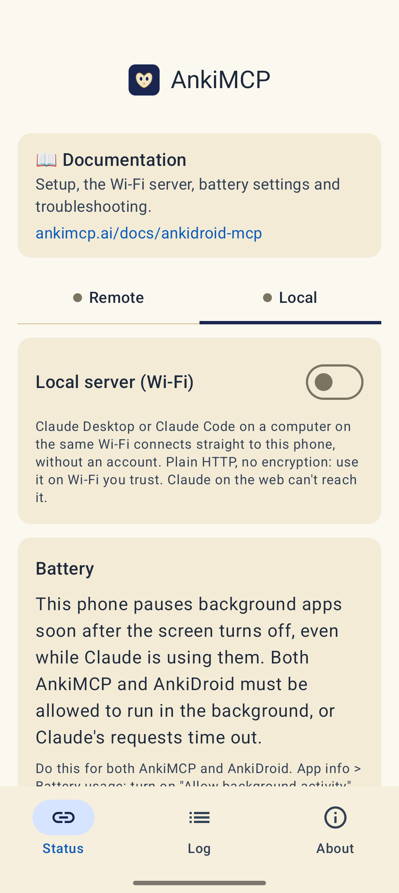
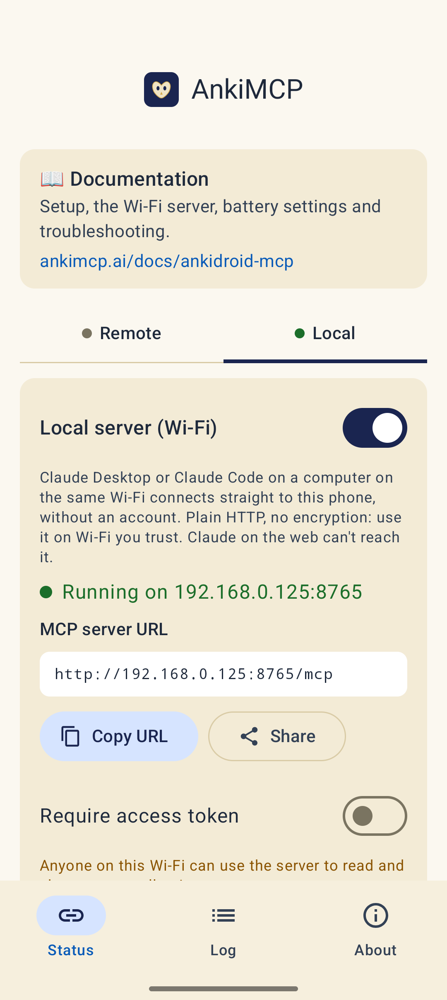
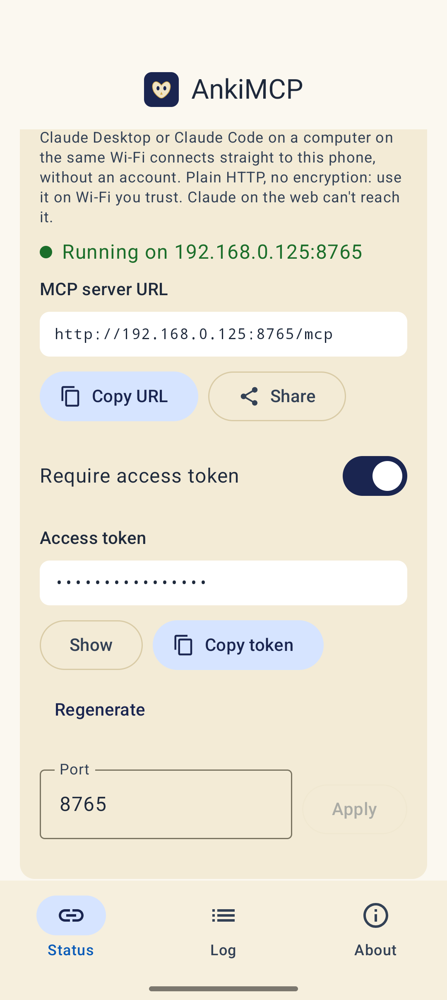
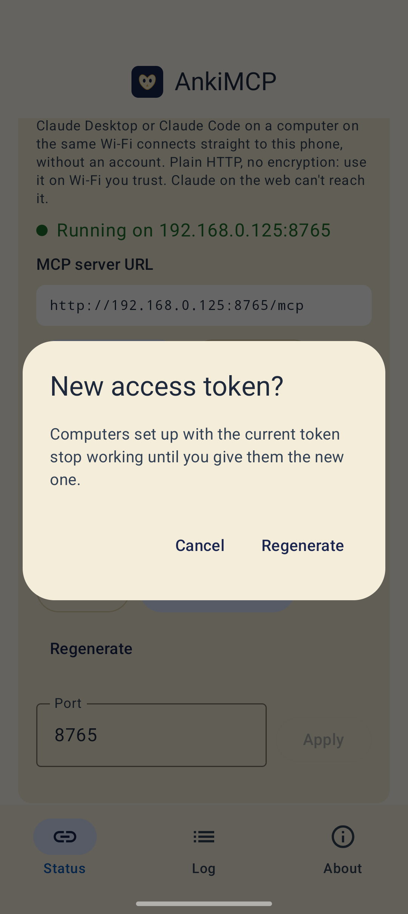
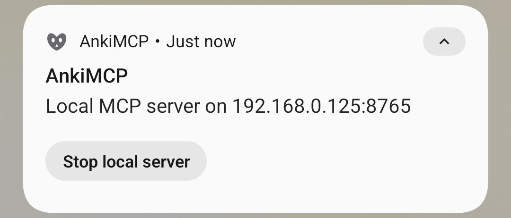
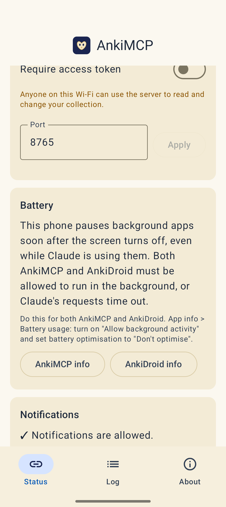

**Run an MCP server on your phone and connect Claude Desktop or Claude Code to it over your home Wi-Fi. You don't need an account, and nothing goes through AnkiMCP's servers.**

In local mode, the AnkiMCP app runs a small server on your phone. A computer on the same Wi-Fi talks to it directly.


Local mode uses plain, unencrypted HTTP. Everything crosses your Wi-Fi in the open, including the access token. Use it only on a home network you trust.


## What you need

- **Android 8.0** or later, with **AnkiDroid 2.24** or later, opened at least once.
- The **AnkiMCP app** for Android, with access to AnkiDroid granted. The app asks for it on first launch; see [Step 1 of Remote access](/docs/ankidroid-mcp/remote-access/#step-1-give-the-app-access-to-ankidroid).
- A computer on the **same Wi-Fi** with **Claude Code**, or **Claude Desktop** plus [Node.js](https://nodejs.org/).

Claude on the web, the Claude mobile app, and Claude Desktop's own **custom connectors** can't use local mode. They connect from Anthropic's cloud, which can't reach a phone on your home network. Use [remote access](/docs/ankidroid-mcp/remote-access/) for those.

**Time:** about 5 minutes.

## Step 1: Turn on the local server

1. On the **Status** tab, open **Local**.
2. Turn on **Local server (Wi-Fi)**.



The card shows **Running on** your phone's address and the **MCP server URL**, for example `http://192.168.0.125:8765/mcp`.



If the card says **Connect to Wi-Fi**, your phone isn't on Wi-Fi. If it says the Wi-Fi gives the phone a public internet address, the server stays off on purpose, because it would be reachable from outside your network.

## Step 2: Turn on the access token (recommended)

Without a token, **anyone on the same Wi-Fi** can read and change your collection. Turn on **Require access token** unless you're the only one on the network.



**Regenerate** replaces the token. Computers set up with the old one stop working until you give them the new one.



## Step 3: Send the URL to your computer

Tap **Copy URL** (and **Copy token**), or tap **Share** to send both at once, for example to yourself by email or a messaging app. Share sends this text:

```text
AnkiMCP on my Wi-Fi
URL: http://192.168.0.125:8765/mcp
Token: <your token>
```

The **Token** line appears only when **Require access token** is on.

## Step 4: Add it to Claude

In the examples below, replace `192.168.0.125:8765` with your own address and `YOUR_TOKEN` with your token.

### Claude Code

```bash
claude mcp add --transport http ankidroid http://192.168.0.125:8765/mcp
```

With the access token on:

```bash
claude mcp add --transport http ankidroid http://192.168.0.125:8765/mcp \
  --header "Authorization: Bearer YOUR_TOKEN"
```

### Claude Desktop

Claude Desktop reaches the phone through [mcp-remote](https://www.npmjs.com/package/mcp-remote), which needs Node.js. Open **Settings → Developer → Edit Config**, add this to `claude_desktop_config.json`, and restart Claude Desktop:

```json
{
  "mcpServers": {
    "ankidroid": {
      "command": "npx",
      "args": ["-y", "mcp-remote", "http://192.168.0.125:8765/mcp", "--allow-http", "--transport", "http-only"]
    }
  }
}
```

With the access token on, pass it through an environment variable:

```json
{
  "mcpServers": {
    "ankidroid": {
      "command": "npx",
      "args": [
        "-y", "mcp-remote", "http://192.168.0.125:8765/mcp", "--allow-http", "--transport", "http-only",
        "--header", "Authorization:${AUTH_HEADER}"
      ],
      "env": { "AUTH_HEADER": "Bearer YOUR_TOKEN" }
    }
  }
}
```

Keep `Authorization:${AUTH_HEADER}` exactly as written, with no space after the colon. The space lives in the `env` value instead, so `npx` doesn't split it.

## Check it worked

Ask Claude: **"list my Anki decks"**. If it names your decks, you're connected.

While the server runs, a notification shows **Local MCP server on** your address, with a **Stop local server** button. The app doesn't need to stay open.



## Change the port

The server uses port **8765** unless you change it. Enter a number from 1024 to 65535 in the **Port** field and tap **Apply**. The server restarts on the new port, so update the URL on your computer.



## Fix common problems

**Claude Code says the server failed to connect.**
Check the address first. If the access token is on, check the token: a missing or wrong token gets a `403 Forbidden` answer asking for `Authorization: Bearer <token>`.

**It fails on a Mac with `EHOSTUNREACH`.**
Allow the app that runs Claude Code or Claude Desktop (Terminal, iTerm, or Claude) under **System Settings → Privacy & Security → Local Network**.

**It worked yesterday, not today.**
Your phone's address probably changed. That happens when it joins another network or gets a new address from the router. Copy the new URL from the app, or reserve a fixed address for the phone in your router.

**The computer can't reach the phone at all.**
Guest Wi-Fi often blocks devices from talking to each other. Put both on the same regular network.

**The phone stops answering when the screen is off.**
Nothing can wake the app in local mode. Turn battery optimisation off for AnkiMCP, and on phones that pause background apps, follow the **Battery** card for both AnkiMCP and AnkiDroid. Set this up before you rely on it with the screen off.

**After a reboot, nothing connects.**
The local server doesn't start on its own after a reboot. Open the app and it comes back.

## Next steps

- Want Claude on the web or on your phone? Set up [remote access](/docs/ankidroid-mcp/remote-access/).
- Want better cards? Try these [AI prompts for Anki](/docs/how-to/anki-ai-prompts/).

---

*Disclaimer: "Anki" is a registered trademark of Ankitects Pty Ltd. AnkiMCP is an independent, community-built project and is **not** affiliated with, endorsed by, or sponsored by Ankitects or the AnkiDroid project. Android is a trademark of Google LLC. MCP is an open standard originated by Anthropic; AnkiMCP is likewise not affiliated with or endorsed by Anthropic.*
