**Connect Claude to AnkiDroid on your phone through the AnkiMCP tunnel. Claude can reach your decks from anywhere: the web, the desktop app, or the Claude app on your phone.**

The AnkiMCP app opens a secure connection from your phone to AnkiMCP's relay. When Claude needs your decks, the relay wakes your phone with a push message, the app answers, and the connection closes again when you're done.

## What you need

- **Android 8.0** or later, with **AnkiDroid 2.24** or later, opened at least once.
- The **AnkiMCP app** for Android.
- An **AnkiMCP account**. You can create one while signing in. The [free tier](/pricing/) is enough to start.
- A **Claude** account.

**Time:** about 5 minutes.

## Step 1: Give the app access to AnkiDroid

1. Open AnkiMCP. The **Set up AnkiMCP** screen checks that AnkiDroid is installed.
2. Under **Access to AnkiDroid**, tap **Grant access**.

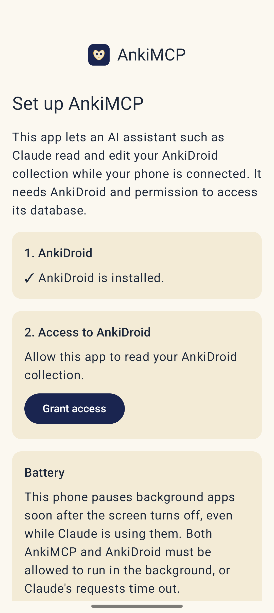

3. AnkiDroid asks whether AnkiMCP may access your notes, cards, note types, and decks. Tap **Allow**.

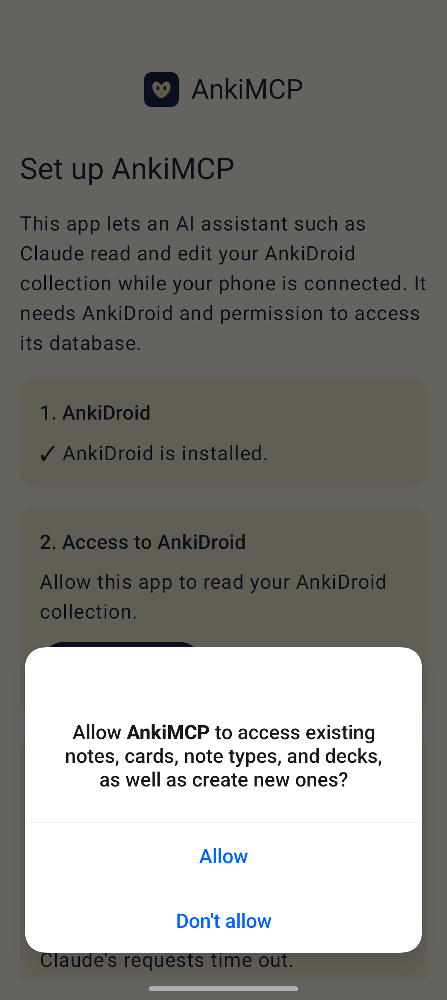

## Step 2: Sign in

1. On the **Status** tab, open **Remote**. **Remote access** is on by default. Tap **Sign in**.

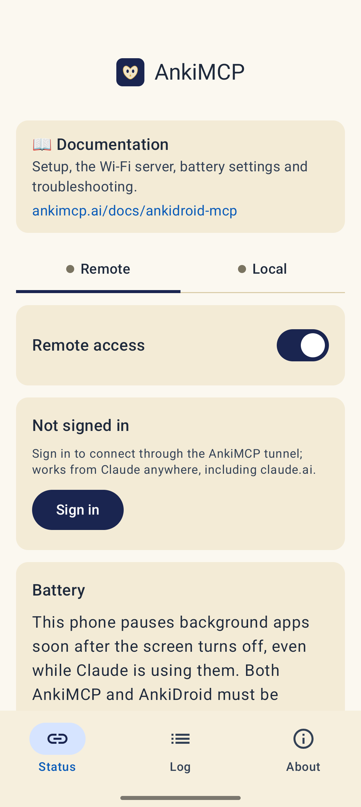

2. The app shows **Your code**. Tap **Open sign-in page**.

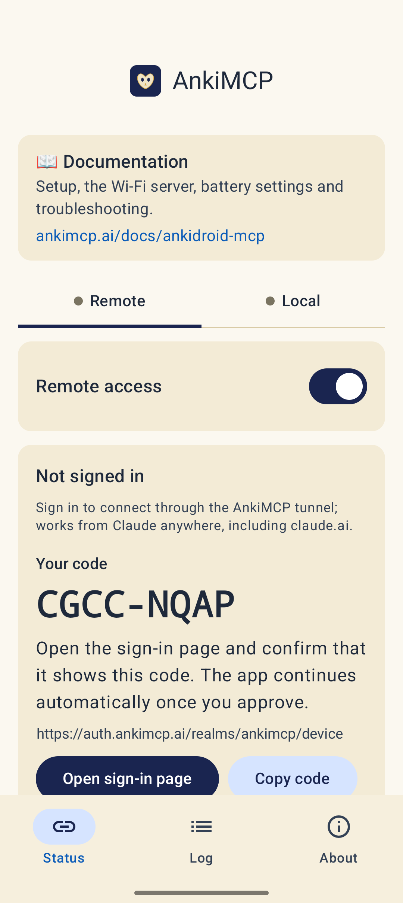

3. Check that the page shows the same code, then sign in with email and password, Google, or GitHub. New here? Tap **Register**.

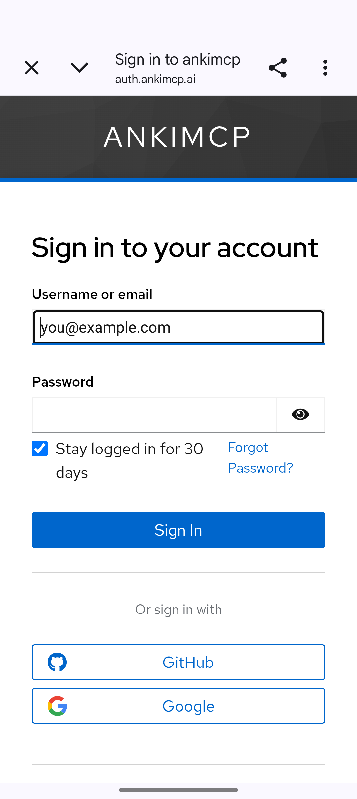

4. On **Grant Access**, tap **Yes**.

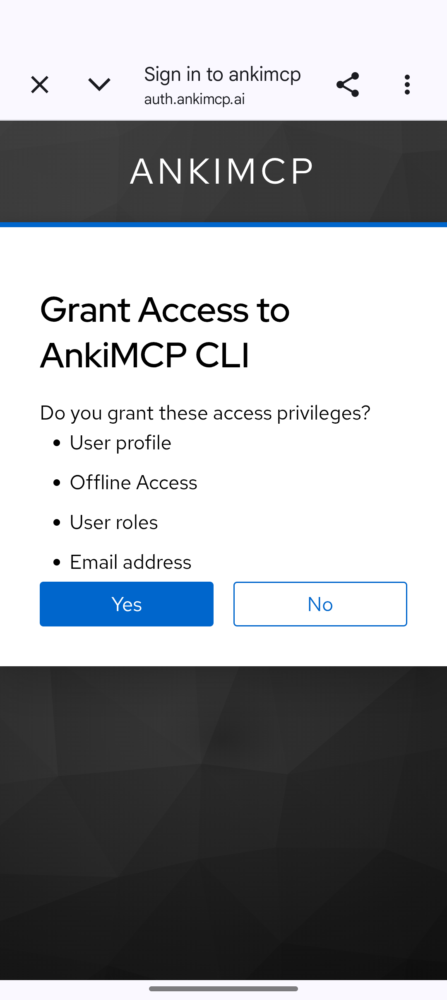

5. When you see **Device Login Successful**, close the browser tab and **go back to the AnkiMCP app**. It finishes signing in on its own, but you only see that when you return to it.

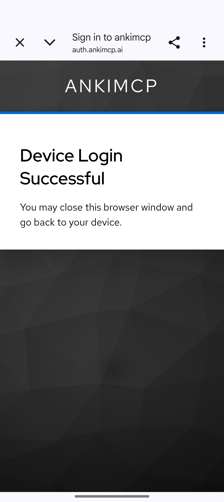

6. On Android 13 and later, the app asks to send notifications. Tap **Allow**. The app works without it, but you won't see when Claude wakes your phone, you won't be told when you need to sign in again, and Android may deliver wake-ups late.

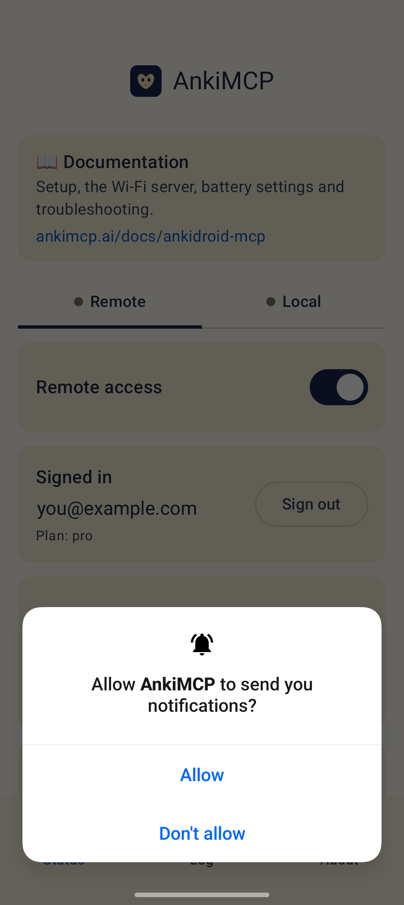

The Remote tab now shows **Signed in** with your email and plan.

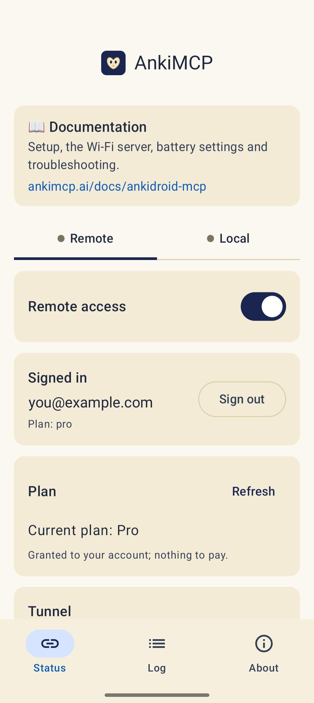

## Step 3: Connect and copy the URL

1. Scroll down to the **Tunnel** card and tap **Connect**.
2. Tap **Copy URL** to copy the MCP server URL. It's the same for everyone:

   ```text
   https://ankidroid.ankimcp.ai/mcp
   ```

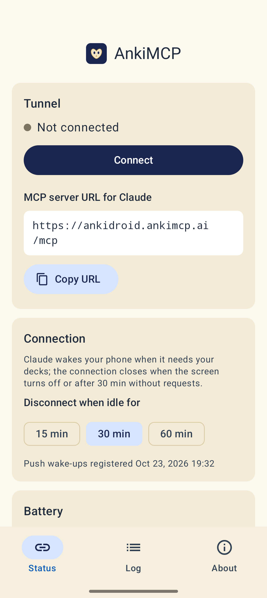

When it's connected, the dot turns green and the card says **Connected: Claude can reach your decks**.

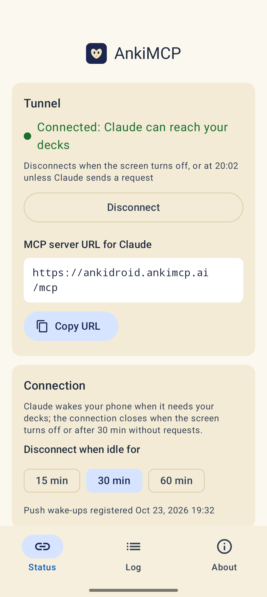

You don't need to stay connected. Later, Claude wakes your phone whenever it needs your decks.

## Step 4: Add the connector in Claude

1. In Claude, go to **Settings → Connectors → Add custom connector**. You can do this on [claude.ai](https://claude.ai) or in the desktop app; the connector then works in the Claude app on your phone too.
2. Paste the URL and sign in with the **same AnkiMCP account** you used in the app.
3. Start a chat and ask: **"list my Anki decks"**.
4. The first time Claude uses a tool, it asks for permission. Tap **Allow once**, or **Always allow** so it stops asking.

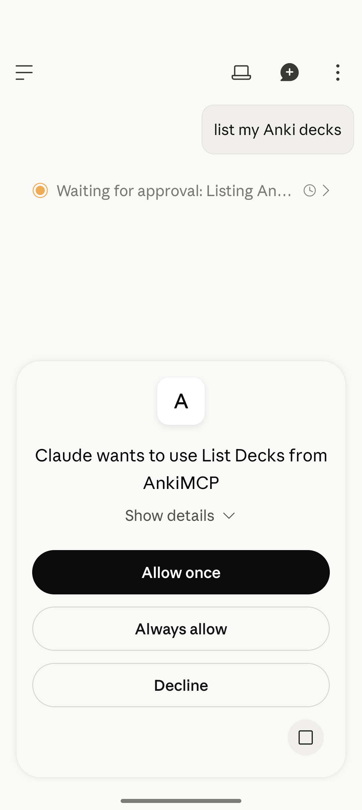

If Claude names your decks, you're set. For more on adding connectors, see [Connect Claude to Anki](/docs/how-to/connect-claude/).

## Step 5: Let the app run in the background

Many phones pause background apps soon after the screen turns off. This is common on Xiaomi, Redmi, Poco, Realme, Oppo, OnePlus, Vivo, iQOO, Huawei, and Honor. Claude's requests then time out.

On these phones, the app shows a **Battery** card with the exact steps for your phone. Do them for **both** apps: tap **AnkiMCP info**, follow the steps, then **AnkiDroid info**, and do the same.

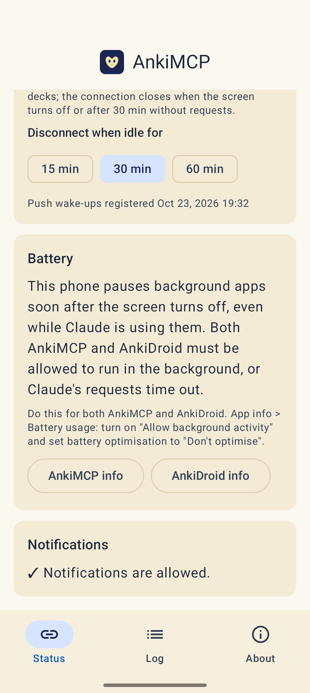

## How it works day to day

- **Waking up.** When Claude needs your decks, nothing pops up. The app connects in the background, and a notification shows **Connected: Claude can reach your decks** with a **Disconnect** button.

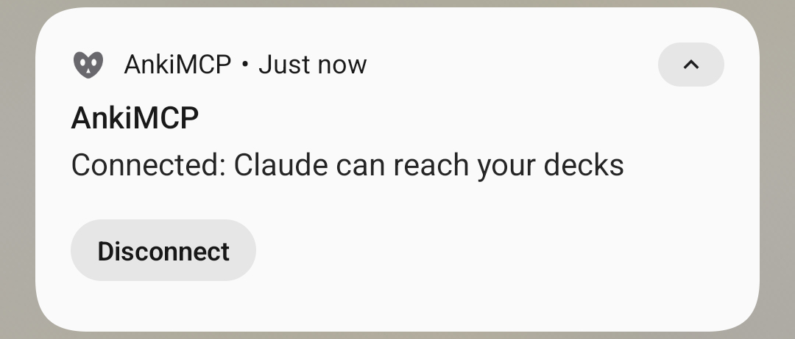

- **Disconnecting.** The connection closes when the screen turns off, or after a set time without requests. Choose **15 min**, **30 min** (the default), or **60 min** under **Disconnect when idle for**.
- **Turning it off.** Switch **Remote access** off at the top of the Remote tab. The app disconnects and stops receiving wake-ups, and Claude tells you AnkiMCP on your phone is turned off. Switch it back on when you want Claude to reach your decks again.

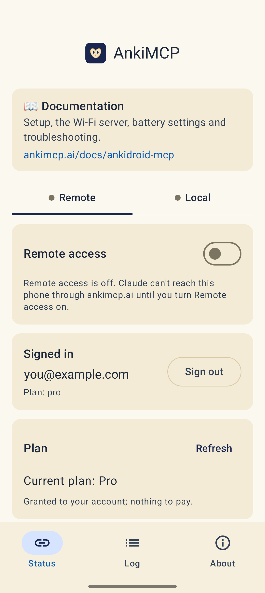

## Fix common problems

**Claude's requests time out.**
Your phone is pausing the app. Set up the [Battery card](#step-5-let-the-app-run-in-the-background) for both AnkiMCP and AnkiDroid.

**Claude says AnkiMCP on your phone is turned off or not signed in.**
Open AnkiMCP, check that you're signed in, and switch **Remote access** on. You also get this message if Claude's connector and the app are signed in to **different** AnkiMCP accounts. Sign both in to the same one.

**A notification says "Sign in again to AnkiMCP".**
Claude tried to reach your decks, but your sign-in expired. Open the app and sign in again. Nothing else is lost.

**Claude sees old cards.**
The app reads the collection on your phone. If you study on other devices too, sync AnkiDroid first. When Claude asks to sync, the app shows a **Tap to sync AnkiDroid** notification.

**Something else.**
Open the **Log** tab, tap **Share log**, and post it on the [community forum](https://forum.ankimcp.ai/). Your email and tokens are removed from the log.

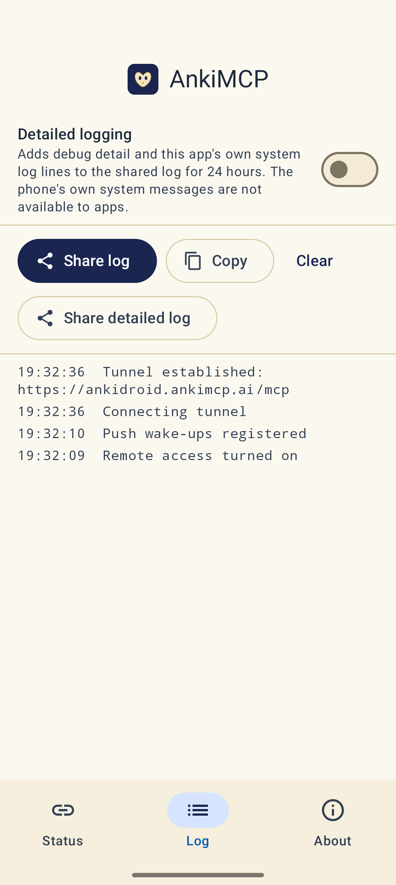

## Next steps

- No account, or Claude on a computer at home? Try [local Wi-Fi](/docs/ankidroid-mcp/local-wifi/).
- Want better cards? Try these [AI prompts for Anki](/docs/how-to/anki-ai-prompts/).

---

*Disclaimer: "Anki" is a registered trademark of Ankitects Pty Ltd. AnkiMCP is an independent, community-built project and is **not** affiliated with, endorsed by, or sponsored by Ankitects or the AnkiDroid project. Android is a trademark of Google LLC. MCP is an open standard originated by Anthropic; AnkiMCP is likewise not affiliated with or endorsed by Anthropic.*
