**Connect Gemini to Anki with the AnkiMCP add-on's built-in tunnel, so Gemini can read your decks and build cards from your browser.**

Gemini runs in the cloud, so it can't see Anki on your computer. The AnkiMCP **add-on** fixes this. It runs inside Anki and, with one click, gives your collection a secure public web address that Gemini can reach. You turn on the tunnel, sign in once, and add the address to Gemini as a custom app.

## What you need

- A **personal Google Account** signed in at [gemini.google.com](https://gemini.google.com). You'll add the tunnel under **Settings → Personal Intelligence → Connected apps → + Custom**. Work and school accounts don't get this option; see [Who can add custom apps?](#who-can-add-custom-apps) below.
- **Anki 25.07 or later**, open on your computer. Get it from [apps.ankiweb.net](https://apps.ankiweb.net/).
- The **AnkiMCP add-on** for Anki, code `124672614`. You'll install it below.
- An **AnkiMCP account**. The tunnel has a [free tier and a paid tier](/pricing/). You sign in the first time you connect it.

**Time:** about 5 minutes.

### Who can add custom apps?

Custom MCP apps are a new Gemini feature, and Google is still rolling it out. Google's [help page](https://support.google.com/gemini/answer/17209137) lists these requirements:

- A **personal Google Account**, not a work or school account.
- **Keep Activity** turned on in Gemini settings. With it off, the Custom apps section is disabled.
- Gemini's language set to **English**.
- Being **18 or over** and **in the US**.

In practice the feature already shows up for accounts outside the US (this guide was written from one), so the region rule seems to be loosening. If you don't see a **+ Custom** button on the Connected apps page, check the account type, Keep Activity, and language first. Google doesn't list a paid plan as a requirement, though some reports tie the feature to Google AI Pro or Ultra. If it's still missing, the feature hasn't reached your account yet. You can use [Claude](/docs/how-to/connect-claude/), [ChatGPT](/docs/how-to/connect-chatgpt-to-anki/), or [Grok](/docs/how-to/connect-grok-to-anki/) with the same tunnel in the meantime.

## Why a tunnel?

Gemini runs on a remote server, not on your machine. It has no way to reach `localhost`, where Anki lives, and Gemini's custom apps accept only a public HTTPS address. The add-on's tunnel gives Anki exactly that: it relays messages between Gemini and your local Anki over a secure, signed-in connection. Your cards never leave your control, and the link is private to your account.

## Step 1: Install the AnkiMCP add-on

The add-on starts a small server inside Anki. It launches on its own every time you open Anki.

1. Open Anki.
2. Go to **Tools → Add-ons → Get Add-ons...**
3. Enter this code: `124672614`
4. Click **OK**, then restart Anki.

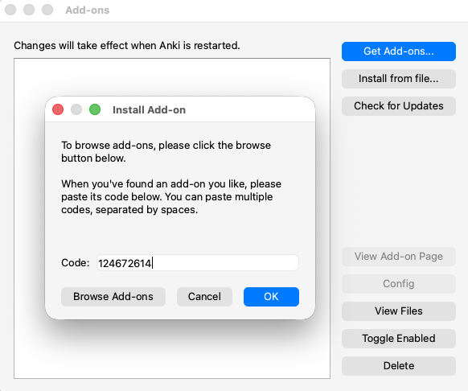

## Step 2: Connect the tunnel and sign in

Now turn on the tunnel so your Anki gets a public web address.

1. Go to **Tools → AnkiMCP Server Settings...**
2. Click **Connect Tunnel**.
3. A login dialog shows a one-time code. Click **Open Browser** and enter that code on the page that opens.
4. Approve the sign-in. The add-on saves your login, so you won't repeat this each time.

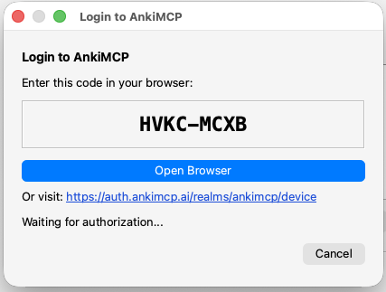

## Step 3: Copy the tunnel URL

The tunnel address is the same for everyone:

```text
https://tunnel.ankimcp.ai/mcp
```

It's safe to share, because it only works after you sign in — requests reach your Anki only when the AI app is signed in with **your** account. Copy that URL. You'll paste it into Gemini next.

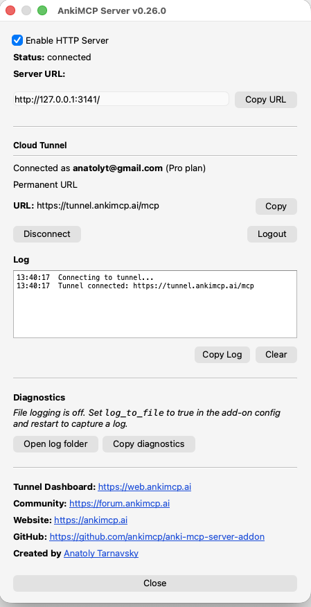

## Step 4: Add the tunnel to Gemini

Open [gemini.google.com](https://gemini.google.com) on a computer. Custom apps can only be added in the web app; once connected, they work in the Gemini mobile app too.

1. Click the **Settings** gear at the bottom of the left sidebar, then **Personal Intelligence**. On the page that opens, click the **Connected apps** card.

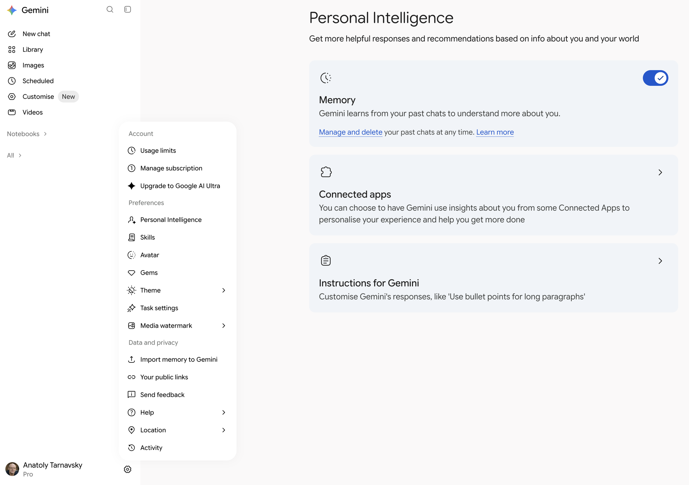

2. On the **Connected apps** page, click **+ Custom** in the top-right corner. A **Connect to an MCP server** dialog opens. Paste your tunnel URL into **MCP server URL** and click **Next**. Leave **Additional settings** closed; it's for servers that need manual client credentials, and AnkiMCP registers itself automatically.

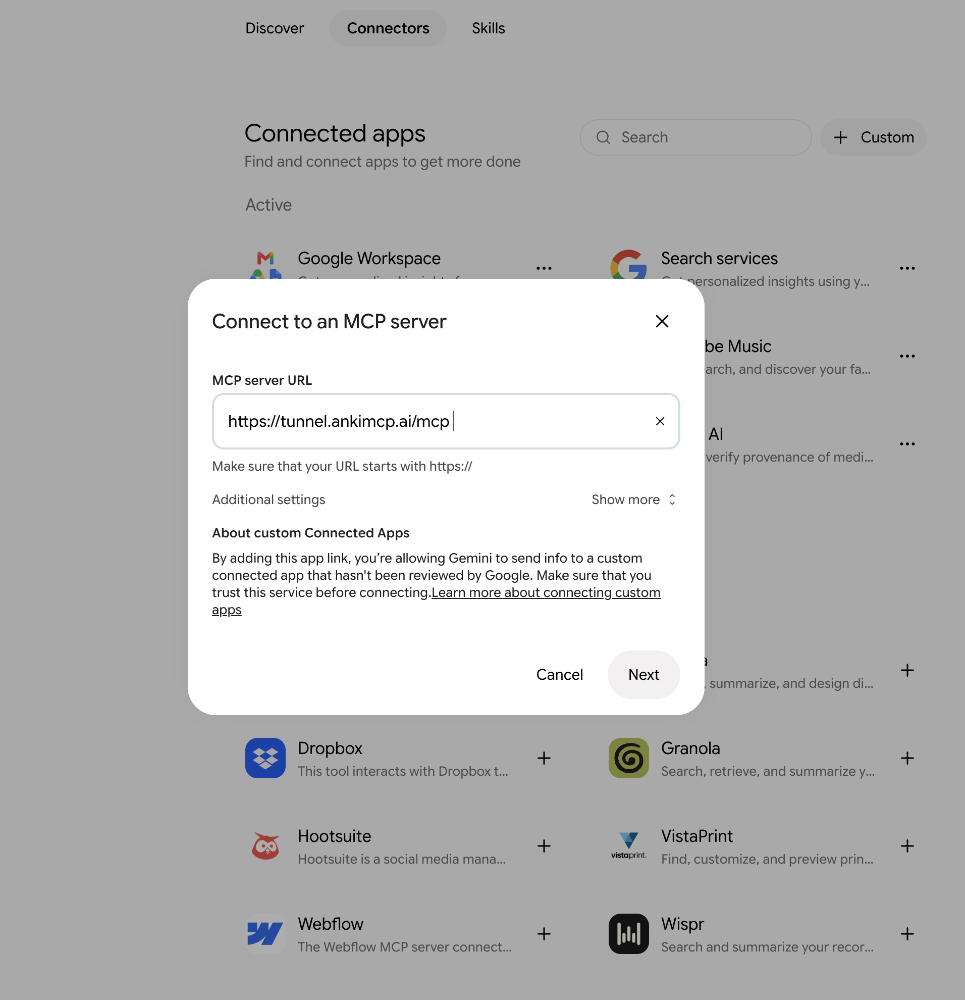

3. Gemini explains what it will do with the server (run its tools, read and share data). Click **Connect**.

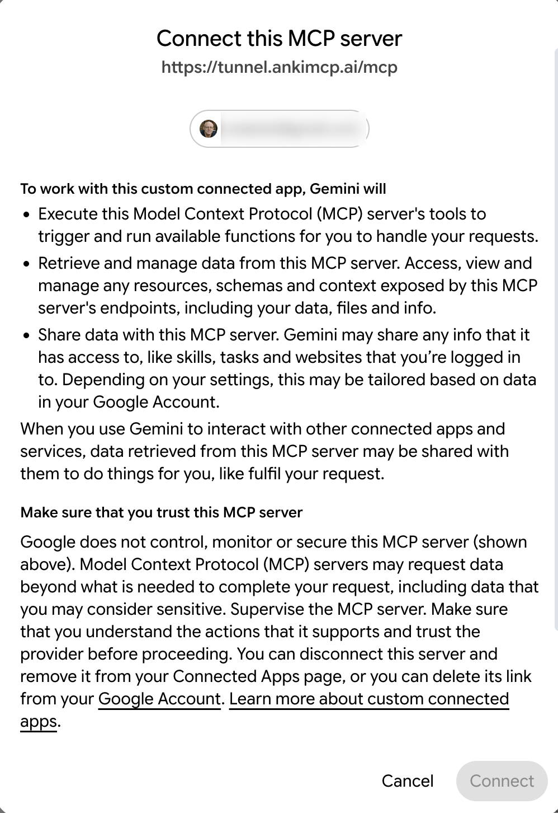

4. Google asks you to link your Google Account with the AnkiMCP app, listed as **[Custom] Ankimcp**. Scroll down and click **Agree and continue**.

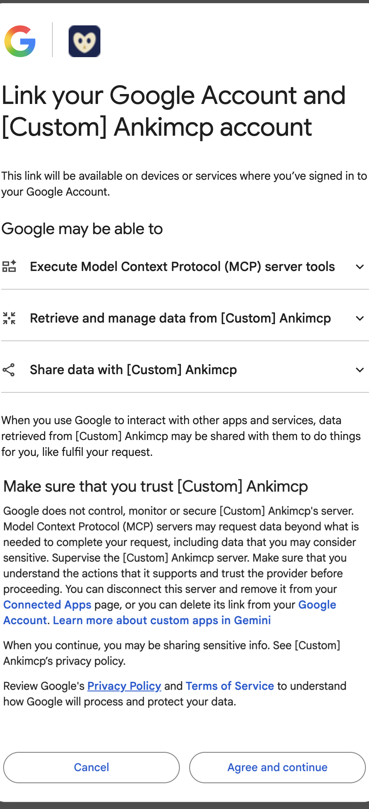

5. AnkiMCP opens and asks you to **Grant Access to Google**. Sign in if prompted, then click **Yes**.

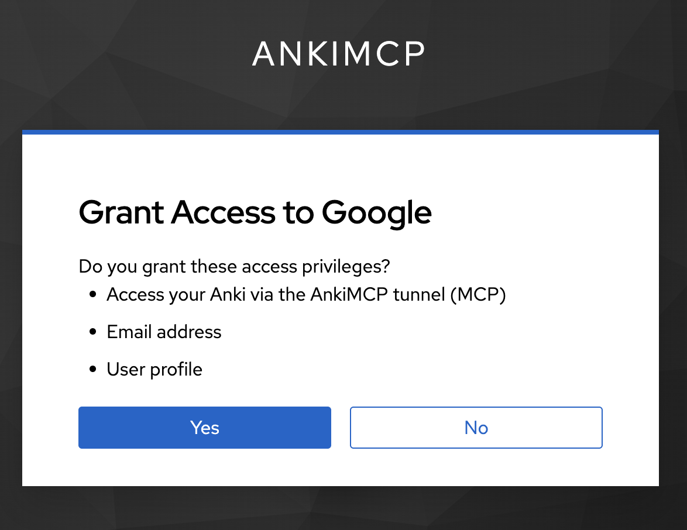

6. Back in Gemini, a **Save your custom app** dialog shows the app name, **Anki Mcp**, and the list of available actions it found (60 of them). Click **Connect**.

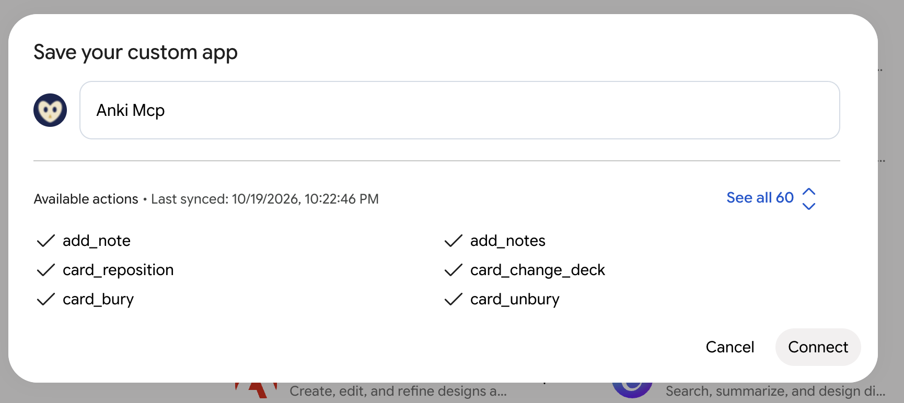

7. **Anki Mcp** now appears under **Custom apps** on the Connected apps page.

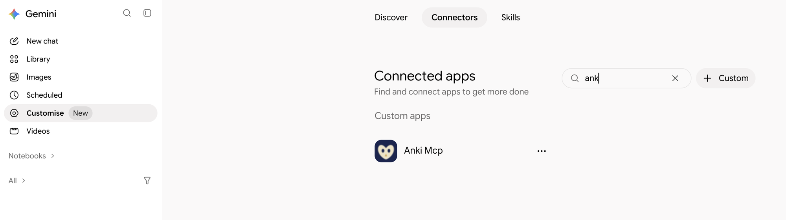

## Check it worked

Keep Anki open, then start a new chat. Type `@`, pick **Anki Mcp** under **Connectors**, and ask: **"can you fetch list of my decks?"**

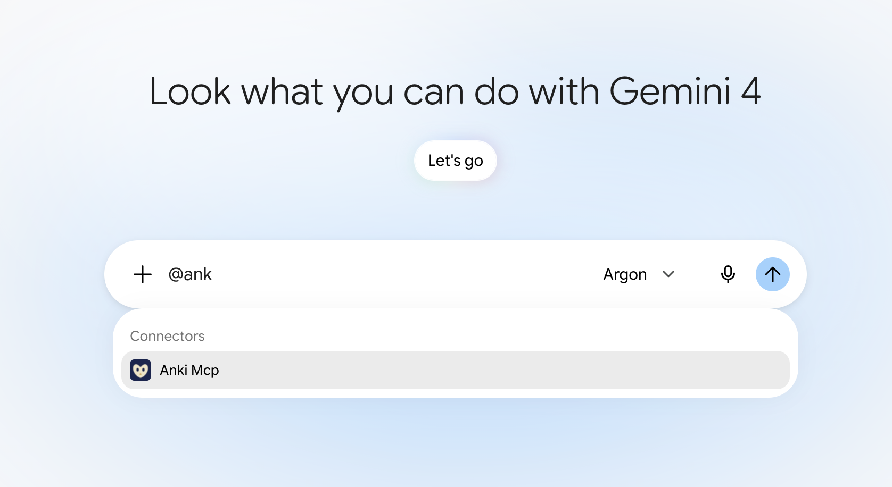

If it names your real decks and card counts, the tunnel works. You can now ask it to make cards, search your collection, or review with you. Mentioning the app with `@` tells Gemini to use it for that message, which is the reliable way to start; after that, it usually reaches for Anki Mcp on its own whenever you talk about Anki.

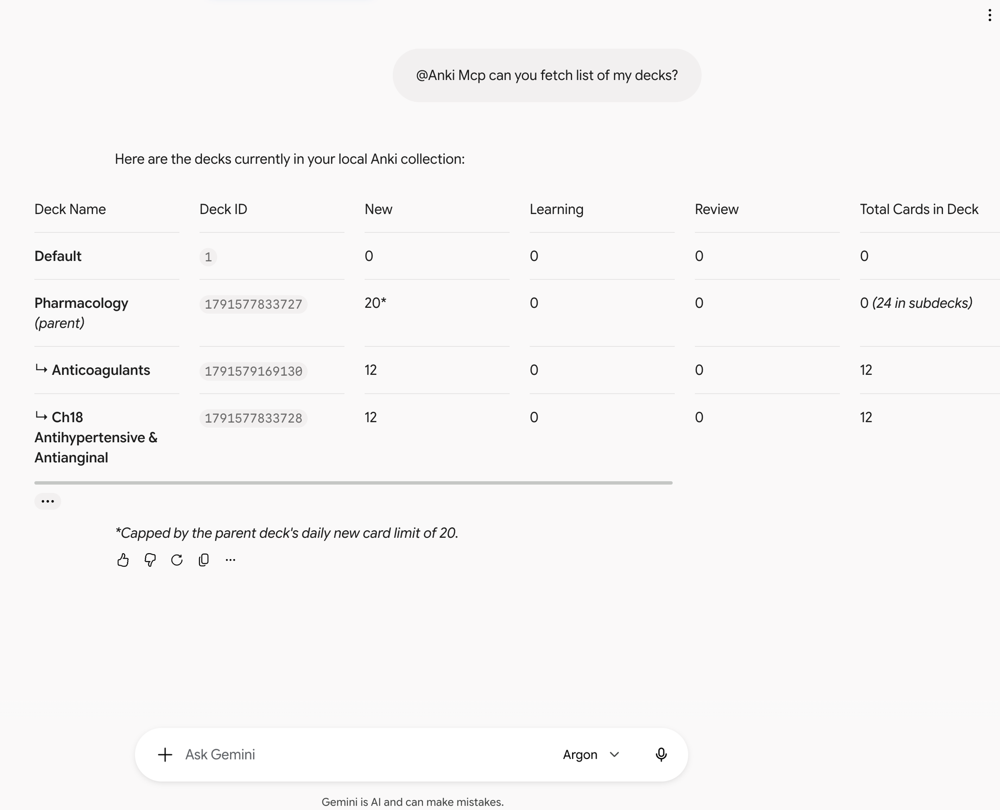

## Fix common problems

**I don't see a + Custom button on the Connected apps page.**
Go back to [Who can add custom apps?](#who-can-add-custom-apps). The usual causes are a work or school account, Keep Activity turned off, or a language other than English. If all three are fine, the feature hasn't reached your account yet.

**Gemini says it can't connect to the app.**
Make sure Anki is open and the tunnel shows as connected in **Tools → AnkiMCP Server Settings...**. The tunnel only relays while Anki is running. Reconnect the tunnel if needed.

**Gemini connects but sees no decks.**
Anki itself may be closed. Open Anki and confirm the tunnel is connected in **Tools → AnkiMCP Server Settings...**.

**Gemini answers from memory instead of using AnkiMCP.**
Start the message with `@Anki Mcp`. Gemini only guarantees a custom app is used when you mention it.

**Sign-in didn't open my browser.**
The login dialog shows a backup link and code. Open the link and enter the code to approve.

## Common questions

**Do I have to pay?**
The add-on is free. The tunnel has a free tier to get started and a paid tier for higher limits — see [pricing](/pricing/). Gemini custom apps are available on a personal Google Account; Google doesn't list a paid Gemini plan as a requirement.

**Does it work in the Gemini mobile app?**
Yes, once you've connected it on the web. You can't add a custom app from the mobile app itself.

**Can I use Gemini CLI instead?**
Yes. Gemini CLI is a terminal tool that connects to MCP servers directly, including local ones, with no custom-apps eligibility. Add AnkiMCP to its `mcpServers` config the same way as other desktop clients; see [Connect other MCP clients](/docs/how-to/connect-mcp-clients/).

## Next steps

- New to local vs. remote? Read [Remote vs local access](/docs/concepts/remote-vs-local/) to choose the right path.
- Want better cards? Try these [AI prompts for Anki](/docs/how-to/anki-ai-prompts/).

---

*Disclaimer: "Anki" is a registered trademark of Ankitects Pty Ltd. AnkiMCP is an independent, community-built project and is **not** affiliated with, endorsed by, or sponsored by Ankitects. Gemini and Google are trademarks of Google LLC; AnkiMCP is not affiliated with or endorsed by Google. MCP is an open standard originated by Anthropic; AnkiMCP is likewise not affiliated with or endorsed by Anthropic.*
